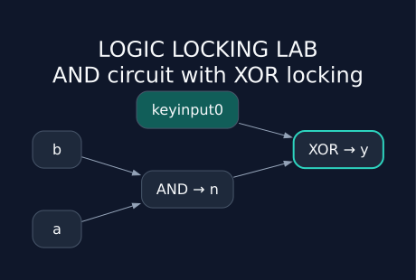
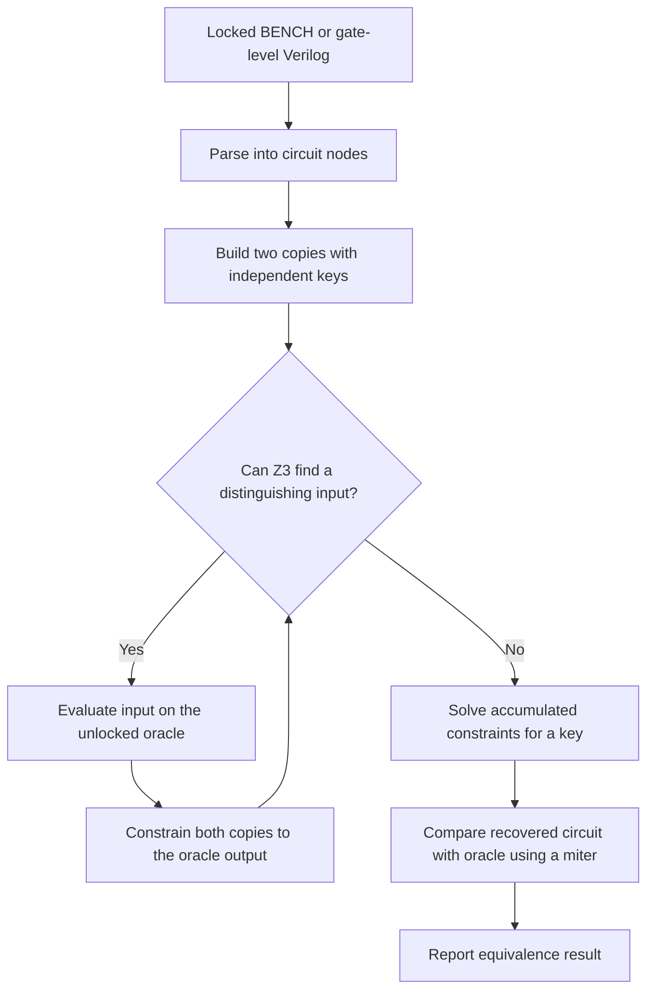

<div align="center">

# Logic Locking Lab

**Explore circuit locking, recover keys, and check functional equivalence.**

A Python research toolkit for gate-level logic locking and oracle-guided SAT attacks.

[Quick start](#quick-start) · [How it works](#how-it-works) · [Source map](#source-map) · [Limitations](#scope-and-limitations)



</div>

Originally developed as a final-year project, this repository brings together graph-based circuit transformations, AntiSAT and SFLL Verilog generators, and a Z3-backed SAT attack. It is a research codebase with a small, tested entry point for exploring how locking and recovery work.

The circuit above is generated from [`and_locked.bench`](examples/circuits/and_locked.bench) using the repository's own parser. The original function is `y = a AND b`; the added XOR gate preserves that function when `keyinput0 = 0`.

## What is implemented

| Area | Implementation | Start here |
| --- | --- | --- |
| Circuit representation | BENCH netlists represented as directed NetworkX graphs | [`Netlist`](src/netlist.py) |
| Gate-level locking | RLL and SLL methods that insert XOR/XNOR gates | [`LogicLocking`](src/LL.py) |
| Post-SAT locking research | AntiSAT and Hamming-distance-based SFLL Verilog generators | [`PostSAT_LL`](src/post_sat.py) |
| Format conversion | BENCH-to-Verilog generation and netlist extraction utilities | [`conv.py`](src/conv.py), [`utils.py`](src/utils.py) |
| Oracle-guided attack | Distinguishing-input search, oracle constraints, and key recovery | [`SatAttack`](satattack/sat_attack.py) |
| Equivalence checking | A Z3 miter checks whether recovered-key outputs can differ from the oracle | [`Circuit`](satattack/circuit.py) |

## Quick start

Use Python **3.10 or newer**. The included attack example needs only the Python dependencies; synthesis tools and external benchmark collections are optional.

```bash
git clone https://github.com/alirafiqmalik/logic-locking-lab.git
cd logic-locking-lab
python3 -m venv .venv
source .venv/bin/activate
python -m pip install -e .

python -m satattack.run \
  examples/circuits/and_locked.bench \
  examples/circuits/and_oracle.bench b
```

On Windows, activate with `.venv\Scripts\Activate.ps1` in PowerShell.

The included locked circuit is deliberately small enough to inspect completely:

```text
INPUT(a)
INPUT(b)
INPUT(keyinput0)
OUTPUT(y)
n = AND(a,b)
y = XOR(n,keyinput0)
```

The run recovers the circuit key and verifies the result. Relevant output:

```text
Found key:    0

Checking for circuit equivalence...

Locked and unlocked circuits match

Iterations: 1
```

Elapsed time and the chosen distinguishing input may vary. The installed command `logic-locking-attack` accepts the same arguments. To run the equivalent gate-level Verilog example:

```bash
logic-locking-attack \
  examples/circuits/and_locked.v \
  examples/circuits/and_oracle.v v
```

## How it works

The attack searches for a **distinguishing input pattern (DIP)**: an input on which two candidate circuit keys produce different outputs. It evaluates that input against the unlocked reference circuit, constrains both candidate circuits to agree with the reference, and repeats. Once the candidates cannot be distinguished, it solves for a remaining key and checks equivalence.



Follow the implementation in [`dip_finder.py`](satattack/dip_finder.py), [`oracle_runner.py`](satattack/oracle_runner.py), and [`sat_attack.py`](satattack/sat_attack.py). The oracle here is a local circuit model, not a remote service or physical device.

## Use the locking code

This example inserts one XNOR gate with circuit key `1` and writes a BENCH file. The intermediate wire `n` supplies an insertion point for the existing RLL implementation.

```python
from pathlib import Path
from src.LL import LogicLocking

original = """INPUT(a)
INPUT(b)
OUTPUT(y)
n = AND(a,b)
y = NOT(n)
"""

Path("build").mkdir(exist_ok=True)
circuit = LogicLocking(original)
circuit.RLL(n=1, key=1)
circuit.graph_to_bench("build/locked.bench")
```

For the Verilog generators, import `PostSAT_LL` from `src.post_sat` and call `AntiSat(...)` or `SFLL(...)`. These emit hierarchical Verilog; synthesis and mapping are needed before feeding that output to the gate-level attack parser. Generator smoke tests check module emission, not security strength or complete synthesis correctness.

## Source map

```text
logic-locking-lab/
├── src/                  Circuit graphs, locking, conversion, generators
├── satattack/            Parsers, Z3 circuit models, oracle, attack CLI
├── examples/circuits/    Small runnable BENCH and Verilog circuit pairs
├── libraries/            Existing Verilog cells and Liberty files
├── benchmarks/           Notes for separately obtained benchmark suites
├── tests/                Workflow and circuit regression checks
├── scripts/              Source-derived diagram generator
├── docs/assets/          Generated circuit diagram and Graphviz source
├── experiments/          Historical drivers, prototypes, artifacts, logs
├── .github/workflows/    Python test workflow
├── NPS.py                Compatibility import for PostSAT_LL
└── pyproject.toml        Dependencies and installed CLI
```

The original `src` and `satattack` import names are retained. The old batch driver in `NPS.py` now lives in [`experiments/post_sat_batch.py`](experiments/post_sat_batch.py); reusable generation code lives in [`src/post_sat.py`](src/post_sat.py). See the [layout and migration notes](docs/project-layout.md) for other moves.

## Development

```bash
python -m unittest discover -s tests -v
```

The six tests cover both attack input formats, the oracle truth table, a locking/export/attack round trip, conversion, generator imports and module emission, and CLI execution outside the checkout. GitHub Actions is configured to run them on Python 3.10 and 3.12.

Regenerate the README image after changing the example (requires Graphviz's `dot` executable):

```bash
python scripts/render_circuit.py
```

Optional synthesis helpers in [`src/cmds.py`](src/cmds.py) use `yosys` and `yosys-abc` from `PATH`. Set `YOSYS` or `ABC` to an executable path when needed. They resolve the cell library from this checkout's `libraries/` directory. The documented installation is editable; these helper templates are intended for a source checkout. The old experiments have additional environment assumptions documented in their [guide](experiments/README.md).

## Scope and limitations

- **Combinational circuits:** the tested attack supports the Boolean gates in [`circuit_builder.py`](satattack/circuit_builder.py). Sequential/DFF attack behavior and literal constant handling are incomplete.
- **Restricted parsers:** BENCH and gate-level Verilog are parsed with regular expressions. Use the included fixtures as formatting references. For Verilog, use separate scalar input declarations and supported `*_g` cells with named `.A`, `.B`, and `.Y` ports. Arbitrary behavioral RTL is not supported.
- **Matching interfaces:** locked and oracle circuits must have corresponding outputs and primary inputs. Circuit key input names must contain lowercase `key`.
- **Research behavior:** random locking choices, solver model selection, and runtime can vary. RLL currently seeds its random choices internally. A recovered key may be functionally equivalent without being the originally inserted bit pattern.
- **Historical results:** [`experiments/results/`](experiments/results/) preserves the original CSV and spreadsheet files. Their environment and provenance are incomplete and some rows repeat; they are not a validated performance comparison.
- **External resources:** the original machine-local tool symlink and incomplete benchmark gitlink are no longer tracked. External benchmark suites are not bundled.

No repository-wide license has been declared. The reorganization preserves existing research material without assigning new license terms.

## Contributing

See [CONTRIBUTING.md](CONTRIBUTING.md) for setup, validation, and how to report a reproducible circuit issue. Useful next steps include stricter parser validation, explicit solver-status handling, and reproducible synthesis-backed generator tests.
